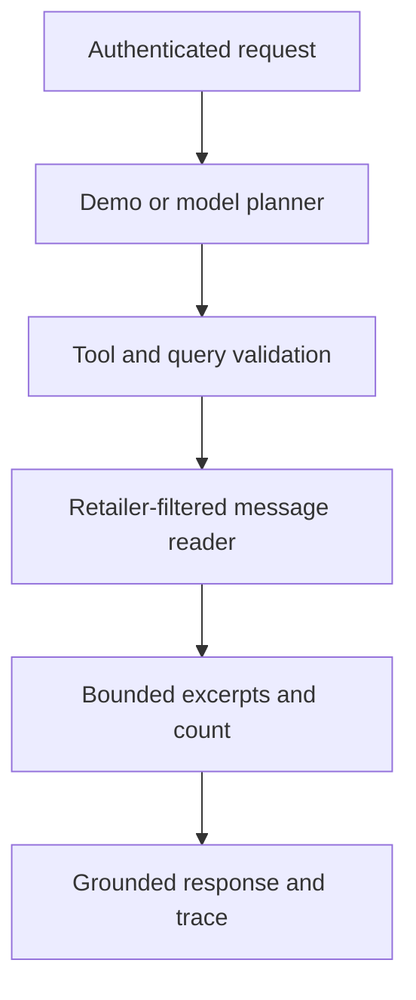

# Message Insight Agent MVP

Inspired by [Agentic AI Architecture: Current Challenges and Future Opportunities](https://www.infoq.com/articles/agentic-ai-architecture-challenges-opportunities/) (Rafał Gancarz, 9 November 2026).

## What runs

A single agent plans one read-only message search/count, validates the plan, calls a retailer-scoped tool and returns deterministic counts and evidence. This applies bounded contexts, bounded context preparation, task-specific coordination and observability to the existing message domain. A multi-agent topology adds no value to this small task, so is deliberately deferred.



The planner has no database/service access and receives only the user's goal. The only tools are `messages.search` and `messages.count`. The server accepts no retailer override or model-supplied URL/SQL. The EF query filter uses the JWT `retailer_id` claim, as existing message APIs do. Excerpts are data and never fed back as instructions. This prevents message-borne prompt injection from influencing planning. Malicious user instructions can still influence the chosen query, but cannot expand the available read capability.

Context/output limits: goal 1000 characters, literal query 100 characters, 1–20 excerpts, 300 characters per excerpt, no attributes. Exact substring matching follows SQLite semantics; this is not semantic search. Counts cover all matching rows, while only the newest matching excerpts are returned. Count and evidence use separate queries and may observe concurrent writes.

## Run locally

Requires .NET 10. Follow the README's trusted JWT issuer configuration. Set a known development signing key through environment variables or user secrets to validate your issuer's tokens; the temporary development key cannot validate externally issued tokens.

```bash
export ASPNETCORE_ENVIRONMENT=Development
export Authentication__Jwt__SigningKey='<your-development-signing-key-at-least-32-bytes>'
dotnet run --project ApiDemo.Api
```

Send a valid token from that issuer with issuer `ApiDemo`, audience `ApiDemoClients`, and a UUID `retailer_id`. Create some messages using the existing authenticated `/api/messages` endpoints. Then:

```bash
curl http://localhost:5089/api/agent/message-insights \
  -H "Authorization: Bearer $TOKEN" \
  -H 'Content-Type: application/json' \
  -d '{"goal":"search:refund","limit":5}'
```

Default `Agent:Mode=demo` supports `search:<literal text>` and `count:<literal text>`. Empty text matches all messages in the authenticated retailer. Demo is a deterministic fixture and performs no LLM inference.

For natural-language planning, configure a chat-completions-compatible provider supporting `response_format: json_object`:

```bash
export Agent__Mode=model
export Agent__Endpoint='https://your-provider.example/v1/chat/completions'
export Agent__Model='<model-name>'
export Agent__ApiKey='<secret-from-your-secret-store>'
```

Then use a goal such as `How many messages mention refund?`. Only this goal is sent to the configured provider. Do not include sensitive content in goals unless approved for that provider. Provider endpoint is server-controlled, must use HTTPS, and redirects are disabled. Planner output has a 150-token cap, 16 KiB response cap, 10-second HTTP timeout and overall 15-second execution deadline. Invalid plans fail closed; there is no automatic retry, fallback, or write operation. HTTP 400 indicates invalid input/demo syntax, 502 a provider/plan failure, 503 configuration failure, and 504 the execution deadline.

Responses contain `mode`, `answer`, `matchCount`, `evidence`, `steps`, `traceId` and `elapsedMs`. Counts and excerpts come from the database; prose is a fixed template rather than an unverified generated summary. The provider is replaceable via `IInsightPlanner`.

## Diagnostics and evaluation

Structured logs record trace ID, mode, elapsed time and failure outcome without goals, message text, provider bodies or credentials. `ApiDemo.MessageInsight` exposes ActivitySource and Meter instruments (`agent.runs`, `agent.duration`); connect a diagnostics listener/exporter to collect them. No exporter or dashboard is bundled. Returned step statuses describe successful execution; failures return safe HTTP errors. No persistent conversation memory, MCP/A2A server, token billing estimate or durable run history is claimed.

Run `dotnet test ApiDemo.sln`. Tests cover retailer isolation, literal SQL-like input, excerpt limits, unsupported tools, invalid requests, cancellation and malformed/oversized provider responses. Real-provider quality and latency require a configured provider and representative goals. Before production add rate limits, provider-specific evaluation, an exporter and workload-specific database performance checks. The bounded output does not guarantee bounded database scan time; the deadline and cancellation are cooperative.
